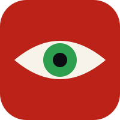
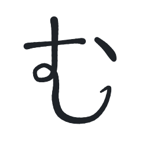
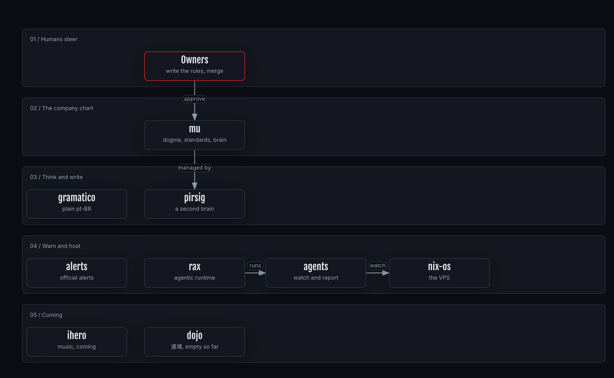

<!-- markdownlint-disable MD033 -->

# mu

the piabrota company chart · <a href="DOGMA.md">dogma</a> · <a href="PIABROTA.md">repos</a> · <a href="docs/DECISION_MODELS.md">decision models</a> · <a href="docs/1-company/charter.md">charter</a> · <a href="#licence">licence</a>

mu is a hard fork of [ouroboric-dev/ouroboric](https://github.com/ouroboric-dev/ouroboric), taken at
[`a2573b3`](https://github.com/ouroboric-dev/ouroboric/commit/a2573b34e28a13b73701e476499db780eec57d36) on 2026-10-27.
The two repos share history up to that commit. mu does not follow upstream.

> [!WARNING]
> mu is not an Ouroboric project, and Ouroboric does not endorse it. Ouroboric is a partner of piabrota. Report
> a problem with mu here, not upstream. [NOTICE.md](NOTICE.md) keeps the credit, the licences and the list of changes.

## In one minute

- **mu is the company chart of [piabrota](https://github.com/piabrota)**, an open software fabric
  made in Rio de Janeiro. It holds the dogma, the charter, the standards, the journal and the tools
  that every piabrota project inherits, and its eight products as submodules.
- **[DOGMA.md](DOGMA.md) holds the ten invariants.** Agents fix every error a user or an owner reports,
  in short pull requests. Judgement is decision-oriented: evidence, a decision model, calibrated
  probabilities, rules that humans define, a verdict.
- **[PIABROTA.md](PIABROTA.md) indexes every public repo of the org.**
- **[pirsig](https://github.com/piabrota/pirsig) will manage this repo:** smart notes, PARA and a
  track record of high-level decisions. [`brain/`](brain/) is its fork state.
- **mu began as a copy of Ouroboric's company repo.** [NOTICE.md](NOTICE.md) keeps that credit.

## The map

**How to read this figure.** Top to bottom, one lane per kind of work. A red border marks the people who steer. The source is [`piabrota-map.json`](docs/archify/piabrota-map.json).

## Contents

| Folder | What's there |
| --- | --- |
| [`1-company/`](docs/1-company/charter.md) | charter, roadmap, budget, legal, readiness, [repositories](docs/1-company/repos.md) |
| [`4-ways-of-working/`](docs/4-ways-of-working/spec-driven-development.md) | the standards every piabrota product follows: [spec-driven development](docs/4-ways-of-working/spec-driven-development.md), [docs](docs/4-ways-of-working/docs-standard.md), [writing styles](docs/4-ways-of-working/writing-styles.md), [diagrams](docs/4-ways-of-working/diagrams.md) |
| [`5-research/`](docs/5-research/README.md) | company-level research |
| [`6-journal/`](docs/6-journal/README.md) | the journey: challenges, solutions, results |
| [`7-branding/`](docs/7-branding/README.md) | the piabrota identity and voice, and the naming record |
| [`forks/`](forks/) | the forks this repo pins: archify, graphify |
| [`brain/`](brain/) | pirsig's fork state: PARA, smart notes, the track record |

The eight products are submodules under [`products/`](products/): clone with `--recurse-submodules`.

## Contributing

Run `uvx pre-commit install` once after cloning, so `gitleaks` checks each commit for secrets.

## Licence

- **Documentation** that came from Ouroboric: [CC BY 4.0](LICENSE).
- **Scripts** (`scripts/`): [AGPL-3.0](LICENSES/AGPL-3.0-only.txt).
- **What piabrota wrote new**, such as the dogma and the Rust templates: [MPL-2.0](LICENSES/MPL-2.0.txt).
  [`REUSE.toml`](REUSE.toml) says which file is which.
- **Names and logos** are not licensed: see [TRADEMARKS.md](TRADEMARKS.md).
