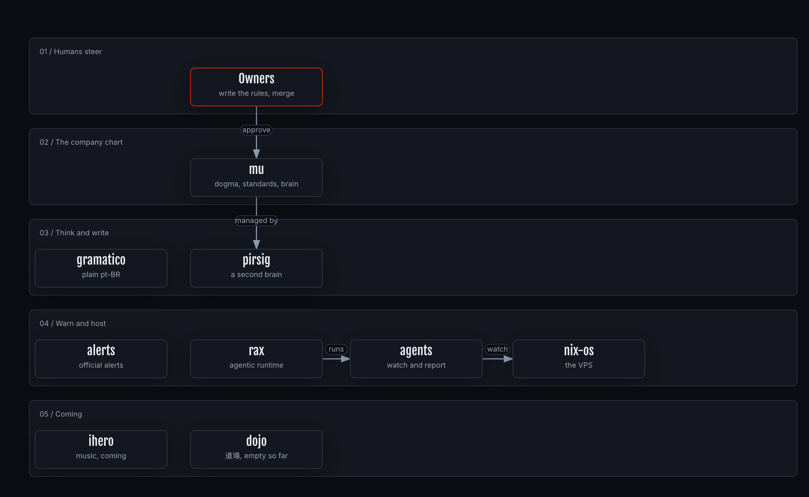

# piabrota charter

This charter sets the highest-level direction for piabrota and everything it builds. Every product
charter must conform to it and to the [dogma](../../DOGMA.md). It replaces the charter this repo
inherited from Ouroboric, and it stays a draft until a human approves it.

## Vision

An open software fabric, made in Rio de Janeiro, where anyone can read the source and the method.

## Mission

Build open projects, each in its own repository, with agents that fix what people report and
decisions that leave a track record.

## Principles

The [dogma](../../DOGMA.md) holds the invariants. These principles explain how we apply them.

1. **Humans steer, agents build.** Work within approved direction runs automatically; any deviation
   from it stops.
2. **Checks, not promises.** Verify claims mechanically wherever possible. Saying "done" proves
   nothing.
3. **Decide on evidence.** Every verdict rests on evidence, a definition of done and rules that
   humans wrote.
4. **Learn in public.** Record challenges, decisions and results honestly, including failures.
5. **Narrow first.** Grow from specific, working projects and extract what is truly shared.

## Values and culture

- **Curiosity over certainty:** we build to learn, and say what we don't know.
- **Honesty about results:** numbers over adjectives; the failed experiment gets written up too.
- **Craft and simplicity:** less code, fewer concepts, clear names.
- **Respect for creators:** licences, credit and consent matter, for code, writing, art and data.

## How this repo is run

[pirsig](https://github.com/piabrota/pirsig) will manage this repo. Areas and projects live in PARA,
thoughts in smart notes, and each high-level decision in a track record with its outcome. Until that
handover, `docs/` stays the source of truth.

## Portfolio

The products are pirsig, alerts, ihero, gramatico, nix-os, dojo, rax and agents, each a submodule under
[`products/`](../../products/). [PIABROTA.md](../../PIABROTA.md) lists every public repo.

**How to read this figure.** Top to bottom, one lane per kind of work. A red border marks the people who steer. The source is [`piabrota-map.json`](../archify/piabrota-map.json).

## North-star measures

- **Errors closed:** how fast a reported error becomes a merged fix.
- **Calibration:** how often a decision made at 90% turns out right, about 90% of the time.
- **Track record:** the share of high-level decisions with a recorded outcome.

## Boundaries

- **Open source** for every project, each under its own licence; names and logos reserved
  ([legal](legal/README.md)).
- **Cost-conscious:** local models and subscriptions first, hard budget caps everywhere
  ([budget](budget.md)).
