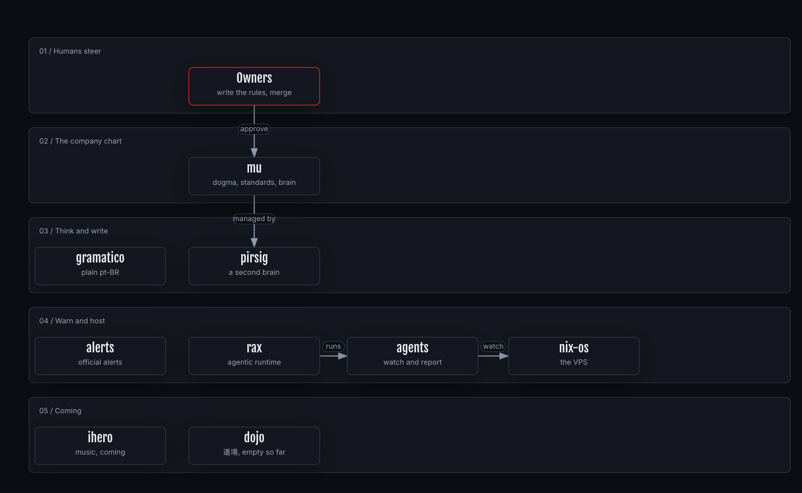

# piabrota

piabrota is an open software fabric made in Rio de Janeiro. This repository, `mu`, is the company
chart. Read the [dogma](../DOGMA.md) first, then the [charter](1-company/charter.md).

## The map

**How to read this figure.** Top to bottom, one lane per kind of work. A red border marks the people who steer. The source is [`piabrota-map.json`](./archify/piabrota-map.json).

## Contents

| Folder | What's there |
| --- | --- |
| [`1-company/`](1-company/charter.md) | charter, roadmap, budget, legal, readiness, [repositories](1-company/repos.md) |
| [`4-ways-of-working/`](4-ways-of-working/spec-driven-development.md) | the standards every piabrota product follows: [spec-driven development](4-ways-of-working/spec-driven-development.md), [docs](4-ways-of-working/docs-standard.md), [writing styles](4-ways-of-working/writing-styles.md), [diagrams](4-ways-of-working/diagrams.md) |
| [`5-research/`](5-research/README.md) | company-level research |
| [`6-journal/`](6-journal/README.md) | the journey: challenges, solutions, results |
| [`7-branding/`](7-branding/README.md) | the piabrota identity and voice, and the naming record |
| [`DECISION_MODELS.md`](DECISION_MODELS.md) | the decision models we track, and where routines run |

[PIABROTA.md](../PIABROTA.md) indexes every public repo of the org. The eight products are submodules under
[`products/`](../products/): clone with `--recurse-submodules`.

Dated records in `5-research/`, `6-journal/` and `1-company/readiness/` keep the name Ouroboric, as
they were written; see [NOTICE.md](../NOTICE.md).
